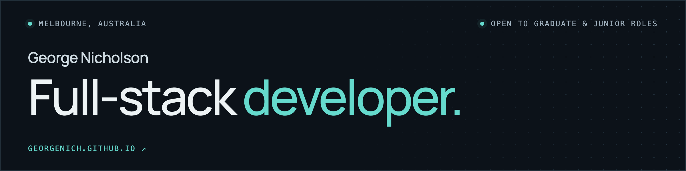
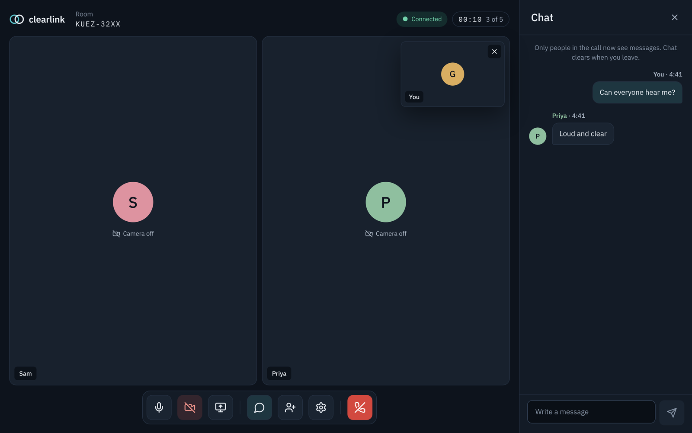

<a href="https://georgenich.github.io"><strong>Portfolio</strong></a> &nbsp;·&nbsp; <a href="https://www.linkedin.com/in/georgenicholson1998/">LinkedIn</a> &nbsp;·&nbsp; <a href="mailto:george.nicholson1998@gmail.com">Email</a>

I build full-stack web applications, real-time systems and data pipelines. Computer Science graduate from Deakin University, with a software development placement at ITConnexion integrating computer vision into a healthcare application. Open to graduate and junior software engineering roles in Melbourne.

---

### Melbourne Traffic Simulator

3D traffic simulation of central Melbourne. A Python pipeline turns OpenStreetMap and City of Melbourne data into a 3D city and SUMO road network, and a WebGL viewer replays the traffic in the browser.

- Calibrated against real morning-peak traffic counts from 45 signalised intersections
- MapLibre and deck.gl share one WebGL depth buffer, so buildings correctly hide traffic behind them
- Contract tests, geometry diagnostics and Playwright tests; 99.7% of vehicle positions fall within the carriageway

Python · SUMO · React · TypeScript · deck.gl · MapLibre

**[Portfolio →](https://georgenich.github.io/#melbourne)** &nbsp; **[Code →](https://github.com/GeorgeNich/Melbourne-traffic-simulator)**

### Clearlink

Peer-to-peer group video calls with screen sharing and chat. A React/TypeScript client and a zero-dependency Node.js signalling server, with audio and video sent directly between browsers over WebRTC and no calling SDK.

- Deterministic offer ownership and per-peer queues avoid conflicting offers when people join at once
- Generation tokens stop outdated camera and microphone requests from leaving capture running
- Node tests and a five-person Playwright call test; also tested across networks, including mobile data

TypeScript · React · WebRTC · Node.js · Playwright

**[Portfolio →](https://georgenich.github.io/#clearlink)** &nbsp; **[Code →](https://github.com/GeorgeNich/clearlink)**

---

### Software development placement · ITConnexion

Healthcare software · October 2024 – January 2025 · Melbourne

Took over an undocumented Laravel/PHP healthcare application and delivered a working wound-tracking product. Integrated a Python FastAPI service using YOLOv8 segmentation to outline wounds and coin, card or ruler references for measurement, and linked the results to patient records, wound history and doctor review.

Laravel · PHP · Python · FastAPI · YOLOv8 · OpenCV · MySQL

---

---

### Computer Science foundations

**Bachelor of Computer Science** · Deakin University · completed September 2025 Diploma of Computing · Deakin College

| Area | Selected work |
| --- | --- |
| **Concurrent and distributed systems** | [PThreads, OpenMP, MPI and OpenCL; parallel programming and benchmarking](https://github.com/GeorgeNich/SIT315-Concurrent-Distributed-Programming) |
| **Advanced algorithms** | [Balanced trees, graph algorithms, shortest paths and dynamic programming](https://github.com/GeorgeNich/SIT320-Advanced-Algorithms) |
| **Data structures** | [Generic collections, sorting, searching, iteration and linked lists in C#](https://github.com/GeorgeNich/SIT221-Data-Structures-and-Algorithms) |
| **Data mining and machine learning** | [Data preparation, PCA, classification, regression and model validation](https://github.com/GeorgeNich/SIT307-Data-Mining-and-Machine-Learning) |
| **Artificial and computational intelligence** | [Adversarial search, Q-learning, heuristic search and fuzzy inference](https://github.com/GeorgeNich/SIT215-Artificial-Computational-Intelligence) |
| **Embedded systems and IoT** | [Particle Argon, Raspberry Pi, sensors, GPIO and cloud communication](https://github.com/GeorgeNich/SIT210-Embedded-Systems-Development) |
| **Data wrangling and analysis** | [Python, NumPy, pandas and exploratory analysis](https://github.com/GeorgeNich/SIT220-Data-Wrangling-and-Analysis) |
| **Object-oriented programming** | [C# and C++: inheritance, polymorphism and application design](https://github.com/GeorgeNich/SIT232-Object-Oriented-Programming) |

---

### Let's connect

**Melbourne, Australia** · Open to graduate and junior software engineering roles

**[Portfolio](https://georgenich.github.io)** · [LinkedIn](https://www.linkedin.com/in/georgenicholson1998/) · [Email](mailto:george.nicholson1998@gmail.com) · [All repositories](https://github.com/GeorgeNich?tab=repositories)
