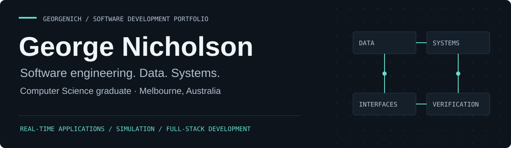
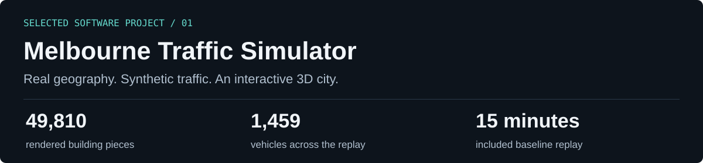
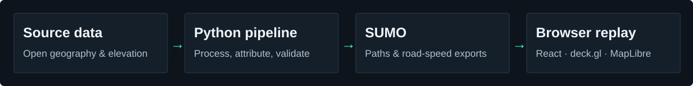
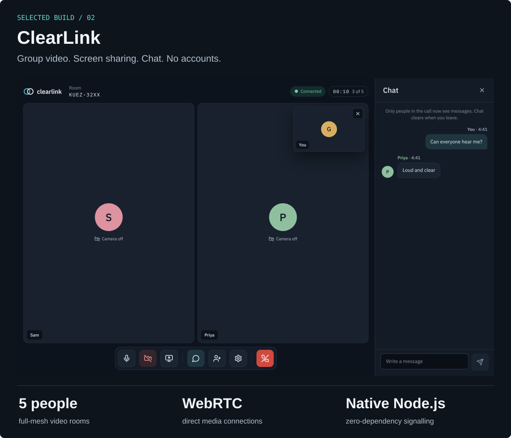
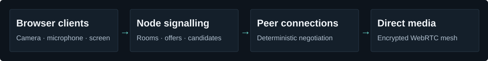
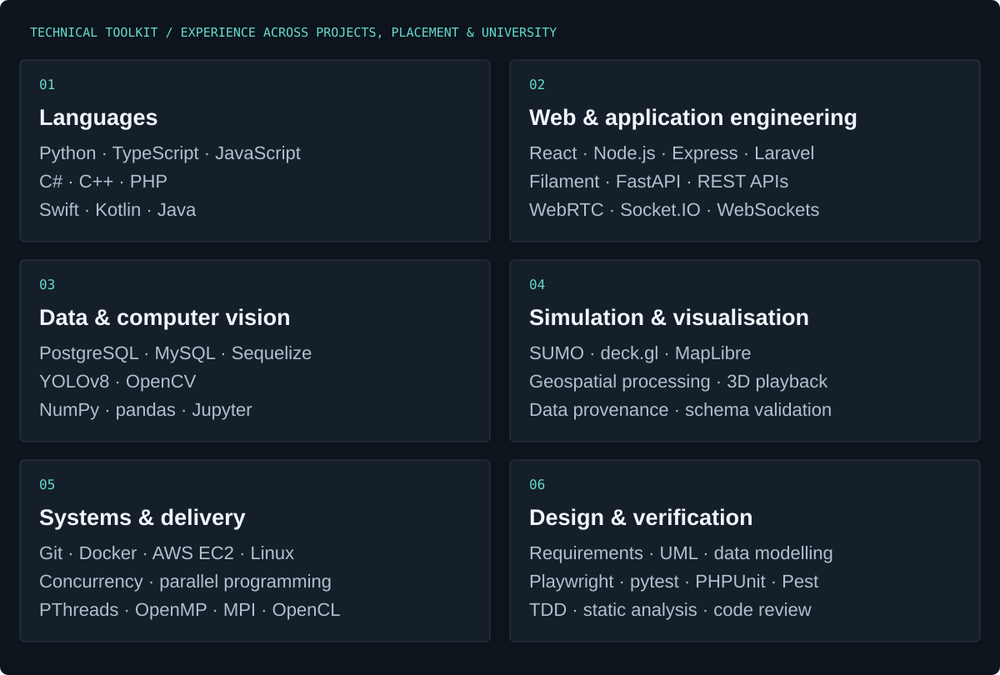
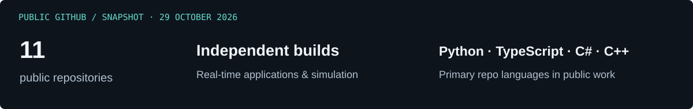

<a href="https://github.com/GeorgeNich?tab=repositories">Explore my work</a> &nbsp; · &nbsp; <a href="https://www.linkedin.com/in/georgenicholson1998/">LinkedIn</a> &nbsp; · &nbsp; <a href="mailto:george.nicholson1998@gmail.com">Email</a>

<a href="#selected-software-projects">Projects</a> &nbsp; · &nbsp; <a href="#it-placement">IT Placement</a> &nbsp; · &nbsp; <a href="#technical-toolkit">Technical Toolkit</a> &nbsp; · &nbsp; <a href="#computer-science-foundations">Computer Science Foundations</a>

## Computer Science Graduate · Software Development

I'm **George Nicholson**, a Bachelor of Computer Science graduate from **Deakin University**, based in Melbourne. I build applications that connect interfaces, data and the systems behind them rangingfrom real-time browser communication to geospatial pipelines and interactive 3D simulation.

My experience spans independent software projects, an **IT placement at ITConnexion working on a healthcare application**, and university work in algorithms, concurrent programming, machine learning and embedded systems.

I enjoy understanding an unfamiliar system, breaking down the problem, building across its layers and checking how it behaves when things go wrong.

**Open to graduate and junior software engineering opportunities in Melbourne**, with interests in full-stack development, backend systems and applied machine learning.

---

## Selected Software Projects

### Melbourne Traffic Simulator

**A browser-based 3D simulation and visualisation of Melbourne's CBD, Southbank and Docklands.** Open geospatial data, Python processing and SUMO simulation feed an interactive replay built with React, TypeScript, deck.gl and MapLibre.

**My contribution:** designed and developed the project across geospatial processing, simulation exports and the browser viewer, investigating data/geometry issues and validating the connections between those layers.

#### Technical Highlights

- **Geospatial processing:** combine roads, buildings and elevation sources; represent stacked structures, bridge clearances, cuttings and tunnels; retain provenance for sourced and estimated values.
- **Simulation and export:** model junction movements, turn restrictions and signals in SUMO, then export timestamped vehicle paths and per-road speed observations.
- **3D rendering:** MapLibre and deck.gl share a graphics context and depth buffer. Playback updates traffic layers without rerendering the React interface every frame.
- **Interactive exploration:** seekable playback, vehicle trails, camera presets, adjustable building opacity, road-speed overlays and an underground X-ray view.
- **Verification:** schema and consistency checks between components, geometry diagnostics, Python/web tests and browser checks of the replay controls.

**Public release:** real geography with synthetic baseline demand. Prepared data is included, so viewing the demo does not require raw source downloads or a running SUMO process. Scope and known geometry limitations are documented in the repository.

**Python · SUMO · React · TypeScript · deck.gl · MapLibre**

**[Explore the code, architecture and setup →](https://github.com/GeorgeNich/Melbourne-traffic-simulator)**

### ClearLink

**Video calls that start with a link.** Account-free group video, screen sharing, in-call chat, device preview and switching, with desktop and phone layouts.

**My contribution:** designed and developed the React/TypeScript application and native Node.js signalling service, including peer negotiation, device lifecycle handling, connection recovery and browser verification.

#### Technical Highlights

- **WebRTC from the protocol up:** a full mesh of direct browser media connections, with deterministic offer ownership and per-peer queues to manage negotiation collisions.
- **Media lifecycle:** generation tokens and per-device request counters stop superseded camera/microphone requests from leaving capture running after navigation.
- **Independent audio and video:** an available device remains usable when the other is absent or permission is denied.
- **A small signalling backend:** native Node.js modules, in-memory rooms and HTTP long polling coordinate setup and chat. Call media travels directly between browsers.
- **Connection recovery:** ICE restart retries retain peer connections, media settings and room membership while the server session remains valid.
- **Browser verification:** the documented Chrome test exercises a five-person call and checks that audio and video reach the participants.

**Scope:** up to five people per room; direct connectivity without a TURN relay. Network, process-lifetime and browser-coverage limits are explained in the repository.

**TypeScript · React · WebRTC · Node.js · Playwright**

**[Explore the code, architecture and setup →](https://github.com/GeorgeNich/clearlink)**

---

## IT Placement · Healthcare Software Development

**ITConnexion · October 2024 – January 2025**

During my IT placement, I worked on an existing Laravel/PHP healthcare application for wound tracking and measurement. My contribution combined understanding the inherited system with integrating computer vision and image-measurement workflows into the application.

- **System understanding:** reverse-engineered the existing codebase and mapped its structure and workflows using high- and low-level UML.
- **Computer-vision integration:** integrated a Python FastAPI service using YOLOv8 segmentation with the Laravel application.
- **Measurement workflows:** implemented coin, card and ruler reference methods to convert image annotations into wound dimensions and area, including user-guided ruler calibration.
- **Interactive annotation:** built automatic and manual annotation workflows, with real-time annotation via WebSockets.
- **Application integration:** connected the work to patient/wound records, appointment history, measurement visualisation and reporting.
- **Development practices:** applied testing and TDD practices while extending the existing application.

**Laravel · PHP · Python · FastAPI · YOLOv8 · OpenCV · MySQL · WebSockets**

---

## Technical Toolkit

Tools and concepts I've worked with across independent projects, my IT placement and university study. The project descriptions show where they fit; the university repositories below distinguish my academic foundations.

**Explore the work behind the toolkit**

- **Applications and APIs:** [ClearLink's WebRTC application and signalling backend](https://github.com/GeorgeNich/clearlink) · [Healthcare placement](#it-placement).
- **Data, simulation and visualisation:** [Melbourne Traffic Simulator](https://github.com/GeorgeNich/Melbourne-traffic-simulator) · [Data wrangling](https://github.com/GeorgeNich/SIT220-Data-Wrangling-and-Analysis) · [Machine learning](https://github.com/GeorgeNich/SIT307-Data-Mining-and-Machine-Learning).
- **Languages, systems and algorithms:** [Concurrent programming](https://github.com/GeorgeNich/SIT315-Concurrent-Distributed-Programming) · [C# data structures](https://github.com/GeorgeNich/SIT221-Data-Structures-and-Algorithms) · [Object-oriented programming](https://github.com/GeorgeNich/SIT232-Object-Oriented-Programming) · [Embedded systems](https://github.com/GeorgeNich/SIT210-Embedded-Systems-Development).
- **Design and verification:** [Melbourne's pipeline and checks](https://github.com/GeorgeNich/Melbourne-traffic-simulator#engineering-the-simulator) · [ClearLink's architecture and browser tests](https://github.com/GeorgeNich/clearlink#architecture--engineering) · [Placement contribution](#it-placement).

<strong>Explore the toolkit in detail</strong>

#### Languages

Python, TypeScript, JavaScript, C#, C++, PHP, Swift, Kotlin and Java.

#### Web applications and APIs

React, Node.js, Express, Laravel, Filament, FastAPI and REST APIs. Real-time work includes WebRTC, Socket.IO and WebSockets.

#### Data and computer vision

PostgreSQL, MySQL and Sequelize; NumPy, pandas and Jupyter; YOLOv8 segmentation, OpenCV, annotation workflows and reference-based image measurement.

#### Simulation and visualisation

SUMO, deck.gl and MapLibre; geospatial processing, 3D vehicle-path replay, data provenance and schema validation.

#### Systems and delivery

Git, Docker, AWS EC2 and Linux environments. University foundations include PThreads, OpenMP, MPI, OpenCL, benchmarking and embedded/IoT development.

#### Design and verification

Requirements analysis, UML, relational data modelling, API contracts, test-driven development, code review and static analysis. Tools across the work include Playwright, pytest, PHPUnit, Pest, PHPStan/Larastan and language-specific checks.

---

## Computer Science Foundations

**Bachelor of Computer Science · Deakin University · completed September 2025**  
Diploma of Computing · Deakin College

Practical implementations and analyses grouped by subject:

| Area | Selected work |
| --- | --- |
| **Concurrent and distributed systems** | [PThreads, OpenMP, MPI and OpenCL; parallel programming and benchmarking](https://github.com/GeorgeNich/SIT315-Concurrent-Distributed-Programming) |
| **Advanced algorithms** | [Balanced trees, graph algorithms, shortest paths and dynamic programming](https://github.com/GeorgeNich/SIT320-Advanced-Algorithms) |
| **Data structures** | [Generic collections, sorting, searching, iteration and linked lists in C#](https://github.com/GeorgeNich/SIT221-Data-Structures-and-Algorithms) |
| **Data mining and machine learning** | [Data preparation, PCA, classification, regression and model validation](https://github.com/GeorgeNich/SIT307-Data-Mining-and-Machine-Learning) |
| **Artificial and computational intelligence** | [Adversarial search, Q-learning, heuristic search and fuzzy inference](https://github.com/GeorgeNich/SIT215-Artificial-Computational-Intelligence) |
| **Embedded systems and IoT** | [Particle Argon, Raspberry Pi, sensors, GPIO and cloud communication](https://github.com/GeorgeNich/SIT210-Embedded-Systems-Development) |
| **Data wrangling and analysis** | [Python, NumPy, pandas and exploratory analysis](https://github.com/GeorgeNich/SIT220-Data-Wrangling-and-Analysis) |
| **Object-oriented programming** | [C# and C++: inheritance, polymorphism and application design](https://github.com/GeorgeNich/SIT232-Object-Oriented-Programming) |

## Public work

## Let's connect

I'm interested in opportunities to build useful software, work through difficult technical problems and develop further as an engineer.

**Melbourne, Australia · Graduate and junior software engineering opportunities**

[LinkedIn](https://www.linkedin.com/in/georgenicholson1998/) · [Email](mailto:george.nicholson1998@gmail.com) · [Browse my repositories](https://github.com/GeorgeNich?tab=repositories)
